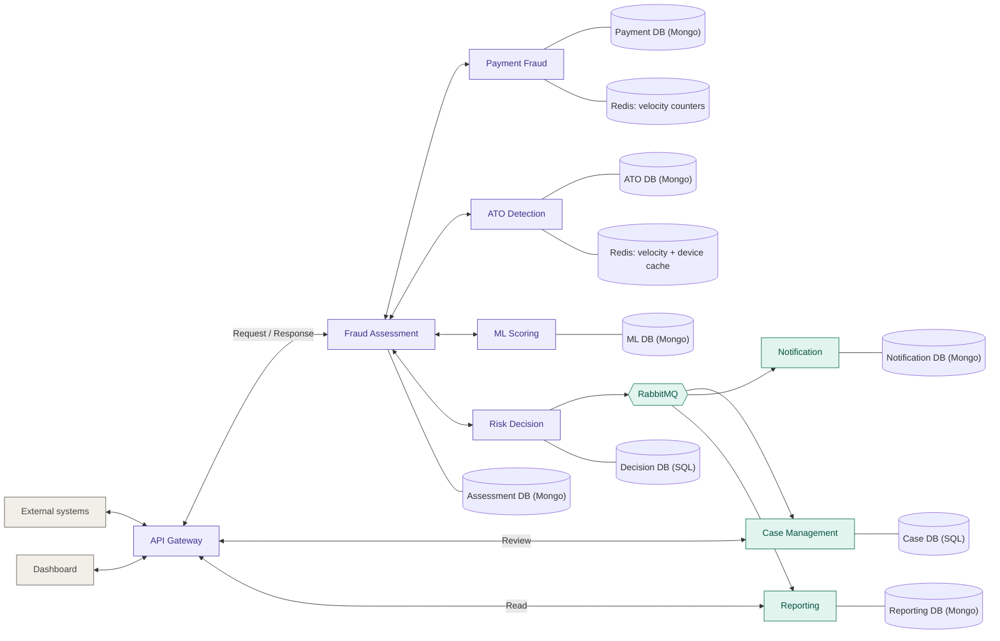

# Real-Time Fraud Detection Platform

A microservices-based **fraud risk engine** built with ASP.NET Core. External systems (payment providers, banking apps, login systems) send events; the platform analyses them in real time and returns a risk decision (`ALLOW`, `REVIEW`, `STEP_UP`, `BLOCK`) with reasons. The platform **never executes payments or blocks logins itself**: the calling system enforces the decision.

Version 1 covers two fraud types:

- **Payment Fraud**: suspicious payment transactions.
- **Account Takeover (ATO)**: suspicious logins and sensitive account changes.

The core is designed so that **Bot Detection** and **Identity / New-Account Fraud** can be added later as new detection services without redesigning the platform.

---

## 1. Goals and non-goals

**Goals**

- Return a risk decision synchronously within the latency budget.
- Combine **Rules** and **Machine Learning** (ML.NET / ONNX Runtime) behind clear interfaces.
- Keep every decision explainable and auditable (which rules, which model version, which policy).
- Let analysts review suspicious cases and feed the outcomes back as training data.

**Non-goals (v1)**

- Executing payments or blocking logins.
- Storing raw card numbers or other sensitive payment data (tokens / hashes only).
- Bot Detection and Identity Fraud (planned, see roadmap).

---

## 2. Actors

| Actor | Description |
|---|---|
| **External System** | Payment gateway, banking app, or login service that sends events and receives decisions. |
| **Fraud Analyst** | Reviews suspicious cases and records the investigation outcome. |
| **Fraud Admin** | Manages rules, decision policies, ML model versions, and users/roles. |
| **Platform (system)** | Background processing: event consumers, notifications, report building. |

---

## 3. Architecture

**Purple = synchronous (REST) path. Teal = asynchronous (RabbitMQ) path.**

### 3.1 Services

| Service | Responsibility |
|---|---|
| **API Gateway** | Single entry point: authentication, authorization, rate limiting, routing. |
| **Fraud Assessment** | Receives assessment requests, validates input, enforces idempotency, orchestrates detection, returns the decision. |
| **Payment Fraud** | Payment rules (velocity, amount, new beneficiary, ...) and payment features. |
| **ATO Detection** | Login/account-change rules (new device, impossible travel, failed attempts, ...), device profiles, login history. |
| **ML Scoring** | Runs the ML model (ML.NET / ONNX Runtime) and returns a risk score; manages model versions. |
| **Risk Decision** | Combines rule results and ML score under a versioned policy and produces the final decision with reason codes. |
| **Case Management** | Creates and manages cases for analyst review; records outcomes. |
| **Notification** | Sends alerts to analysts and systems. |
| **Reporting** | Builds read models and KPIs for the dashboard. |

### 3.2 Communication rules

- **REST (synchronous):** used when the caller needs the result before it can respond: Gateway → Assessment → Payment / ATO / ML / Decision.
- **RabbitMQ (asynchronous):** used for work that may happen after the response: cases, alerts, reports.
- The platform never waits for an email, a case, or a report before returning the decision.

### 3.3 Data ownership

Each service owns its database. **No service reads another service's database**; services share only IDs (e.g. `assessmentId`) and events.

The platform uses **polyglot persistence**: **MongoDB** for flexible, event-shaped data, **SQL Server** for the two services with structured, relational, workflow-driven data (Risk Decision and Case Management), and **Redis** for fast, short-lived data (velocity counters and hot caches) in Payment Fraud and ATO Detection.

| Service | Database | Main collections / tables / keys |
|---|---|---|
| Fraud Assessment | MongoDB | `assessments`, `idempotency_records`, `outbox` |
| Payment Fraud | MongoDB + **Redis** | Mongo: `payment_rules`, `payment_rule_results`. Redis: velocity counters (e.g. attempts per card/account/IP per time window) |
| ATO Detection | MongoDB + **Redis** | Mongo: `ato_rules`, `ato_rule_results`, `device_profiles`, `login_history`. Redis: failed-login counters, recent-device cache |
| ML Scoring | MongoDB | `model_registry`, `score_logs` |
| Risk Decision | **SQL Server** | `Decisions`, `DecisionReasons`, `DecisionPolicies`, `OutboxMessages` |
| Case Management | **SQL Server** | `FraudCases`, `CaseNotes`, `CaseOutcomes`, `InboxMessages` |
| Notification | MongoDB | `notification_log`, `subscriptions`, `inbox` |
| Reporting | MongoDB | `read_models`, `inbox` |

Notes:

- MongoDB multi-document transactions (needed for Outbox/Idempotency in Assessment) require running MongoDB as a **replica set**, even locally.
- Risk Decision and Case Management use relational tables with foreign keys **inside their own database only** (e.g. `Decisions` → `DecisionReasons`, `FraudCases` → `CaseNotes`), and SQL transactions for the Outbox/Inbox.
- **Redis usage:** counters use atomic `INCR` with a **TTL** equal to the rule's time window (sliding or fixed window), so old counts expire automatically. Redis holds derived, short-lived data only; the durable record stays in MongoDB.
- **Redis failure:** if Redis is unavailable, velocity rules fall back to a Mongo query or are skipped, and the decision records that velocity data was unavailable (same idea as the ML fallback in UC-05).
- Idempotency is enforced with a **unique index** on `(clientId, idempotencyKey)`.
- Sensitive payment data is stored as **token/hash only**.

### 3.4 Reliability patterns

- **Idempotency key** on assessment requests: the same request twice returns the same response.
- **Transactional Outbox** in Assessment and Decision: a decision is never saved without its event being published eventually.
- **Inbox** in every consumer + idempotent handlers: RabbitMQ may deliver a message more than once.
- **Dead-Letter Queues** for messages that keep failing.
- **Timeout + Fallback** around ML Scoring (see UC-05) and around Redis lookups.
- **Versioning:** every decision stores the rule versions, model version, and policy version used.

### 3.5 Key events

| Event | Published by | Consumed by |
|---|---|---|
| `FraudAssessmentCompleted` | Risk Decision | Case Management, Notification, Reporting |
| `FraudCaseOpened` | Case Management | Notification, Reporting |
| `FraudCaseResolved` | Case Management | Reporting, ML Scoring (training data) |
| `RuleSetChanged` | Payment Fraud / ATO Detection | Reporting (audit) |
| `PolicyChanged` | Risk Decision | Reporting (audit) |
| `ModelActivated` | ML Scoring | Reporting (audit) |

---

## 4. Functional requirements

| ID | Requirement |
|---|---|
| FR1 | Receive payment events from external systems. |
| FR2 | Receive login and sensitive account-change events. |
| FR3 | Validate input and prevent duplicate processing. |
| FR4 | Apply fraud rules per fraud type. |
| FR5 | Compute an ML risk score. |
| FR6 | Combine results into a decision with reason codes. |
| FR7 | Return the decision to the external system immediately. |
| FR8 | Open cases for suspicious events; analysts review and record outcomes. |
| FR9 | Manage rules, policies, and models with versions. |
| FR10 | Send alerts to analysts. |
| FR11 | Provide dashboard and reports. |
| FR12 | Keep an audit log of decisions and configuration changes. |

## 5. Non-functional requirements

The numbers are **initial targets** for the graduation project and should be revisited after load testing.

| Quality | Target | Architectural impact |
|---|---|---|
| Latency | Decision in < 300 ms (p95) | Lean synchronous path; heavy work async |
| Throughput | ~100 events/s at peak | Scale each service independently |
| Availability | 99.5% for assessment | Multiple instances, health checks |
| Resilience | Platform still decides if ML is down | Timeout + fallback policy |
| Consistency | No lost events | Outbox, Inbox, DLQ |
| Idempotency | Same request → same response | Idempotency key |
| Security | Authenticated clients, role-based dashboard | Gateway, OAuth2 / JWT, RBAC |
| Data protection | No raw card data | Tokenization / hashing |
| Auditability | Any decision can be explained later | Stored versions and reason codes |
| Observability | Trace a request across services | Correlation ID, logs, traces, metrics |
| Extensibility | Add new fraud types easily | Detection services with a common contract |
| Detection quality | Track precision, recall, false positives | Case outcomes feed evaluation |

---

## 6. Use cases

### UC-01: Assess a payment transaction

- **Actor:** External System
- **Trigger:** A payment is about to be executed.
- **Preconditions:** The client is authenticated; the request carries an idempotency key.
- **Main flow:**
  1. The system sends a payment event (amount, currency, token of the payment instrument, merchant, device/IP, timestamp) to the Gateway.
  2. The Gateway authenticates the client and forwards the request to Fraud Assessment.
  3. Fraud Assessment validates the payload and checks idempotency.
  4. It calls Payment Fraud (rules) and ML Scoring (score).
  5. It sends both results to Risk Decision.
  6. Risk Decision applies the active policy and returns `ALLOW`, `REVIEW`, or `BLOCK` with reason codes.
  7. The assessment and decision are saved; `FraudAssessmentCompleted` is written to the outbox.
  8. The decision is returned to the external system.
- **Alternative flows:** invalid payload → `400` with details; duplicate request → UC-04; ML failure → UC-05.
- **Postconditions:** assessment and decision stored; event published asynchronously.

### UC-02: Assess a login event

- **Actor:** External System (login service)
- **Trigger:** A user attempts to log in.
- **Main flow:**
  1. The system sends a login event (account id, device fingerprint, IP, approximate location, result of credential check, timestamp).
  2. Assessment validates the request and checks idempotency.
  3. It calls ATO Detection (rules + device profile + login history) and ML Scoring.
  4. Risk Decision returns `ALLOW`, `STEP_UP` (extra verification), or `BLOCK` with reasons.
  5. Result is stored, event published, response returned.
- **Alternative flows:** unknown device → higher risk; repeated failures → `BLOCK`/`STEP_UP`; ML failure → UC-05.
- **Postconditions:** login history and device profile updated.

### UC-03: Assess a sensitive account change

- **Actor:** External System
- **Trigger:** Password change, email/phone change, new trusted device, or new payee added.
- **Main flow:** same as UC-02, using the change type as an input signal. Sensitive changes shortly after a risky login raise the risk.
- **Result:** `ALLOW`, `STEP_UP`, or `BLOCK` with reasons.

### UC-04: Handle a duplicate request

- **Actor:** External System
- **Trigger:** The same request (same idempotency key) is sent again, for example after a timeout.
- **Main flow:** Assessment finds the existing idempotency record and returns the **stored response** without re-running detection.
- **Alternative flows:** same key with a different payload → `409 Conflict`; first request still processing → `409`/`202` according to API contract.
- **Postconditions:** no duplicate assessment, decision, or event.

### UC-05: Handle ML service failure

- **Actor:** Platform
- **Trigger:** ML Scoring times out or returns an error.
- **Main flow:**
  1. Assessment applies a short timeout to the ML call.
  2. On failure it continues with rule results only.
  3. Risk Decision applies the **fallback policy** (e.g. rules-only, or `REVIEW`/`STEP_UP` for high-risk contexts).
  4. The decision is flagged `mlUnavailable = true`.
- **Postconditions:** decision stored with the flag so these cases can be separated in analysis; an alert/metric is raised.

### UC-06: Review a fraud case

- **Actor:** Fraud Analyst
- **Trigger:** A decision of `REVIEW`/`BLOCK` (or policy-defined) opens a case.
- **Preconditions:** the analyst is authenticated with the analyst role.
- **Main flow:**
  1. Case Management consumes `FraudAssessmentCompleted` and opens a case.
  2. Notification alerts analysts (UC-13).
  3. The analyst lists cases (filters: status, type, risk, date) and opens one.
  4. The analyst sees the event data, rule hits, ML score, reason codes, and related history.
  5. The analyst adds notes and assigns the case to themselves.
- **Postconditions:** case status updated to `IN_REVIEW`.

### UC-07: Resolve a case

- **Actor:** Fraud Analyst
- **Main flow:**
  1. The analyst selects an outcome: `CONFIRMED_FRAUD`, `FALSE_POSITIVE`, or `INCONCLUSIVE`.
  2. The case is closed and `FraudCaseResolved` is published.
  3. Reporting updates metrics; ML Scoring stores the labelled outcome for future training and evaluation.
- **Postconditions:** the action is written to the audit log.

### UC-08: Manage payment rules

- **Actor:** Fraud Admin
- **Main flow:** create / edit / enable / disable a payment rule (e.g. velocity threshold, high-amount limit, new-beneficiary check). Each change creates a **new version**; the previous version is kept.
- **Alternative flows:** invalid rule definition → validation error.
- **Postconditions:** `RuleSetChanged` published; audit entry written.

### UC-09: Manage ATO rules

- **Actor:** Fraud Admin
- **Main flow:** same as UC-08 for login/account rules (new device, impossible travel, failed-attempt velocity, sensitive-change-after-login).

### UC-10: Manage decision policy

- **Actor:** Fraud Admin
- **Main flow:**
  1. The admin defines risk thresholds and combination logic (how rule results and the ML score map to `ALLOW`/`REVIEW`/`STEP_UP`/`BLOCK`).
  2. The admin defines the **fallback policy** for ML failure.
  3. The new policy version is activated.
- **Postconditions:** `PolicyChanged` published; every future decision records the policy version.

### UC-11: Manage ML model versions

- **Actor:** Fraud Admin
- **Main flow:** register a new model version (ML.NET or ONNX file + metadata), view its evaluation metrics, activate it, or roll back to a previous version.
- **Postconditions:** `ModelActivated` published; scores are logged with the model version.

### UC-12: View dashboard and reports

- **Actor:** Fraud Analyst, Fraud Admin
- **Main flow:** the user opens the dashboard and sees volumes, decision distribution, open cases, rule hit rates, false-positive rate, and latency indicators, with filters by date and fraud type.
- **Data source:** Reporting read models only.

### UC-13: Receive alerts

- **Actor:** Fraud Analyst
- **Trigger:** `FraudCaseOpened` / high-risk `FraudAssessmentCompleted`.
- **Main flow:** Notification consumes the event and sends the alert through the configured channel, then records delivery status.
- **Alternative flows:** delivery fails → retry, then dead-letter queue.

### UC-14: Query an assessment

- **Actor:** External System
- **Main flow:** the system requests an assessment by id and receives its status and decision, limited to what that client is allowed to see (no internal rule details).

### UC-15: Explain a past decision (audit)

- **Actor:** Fraud Analyst, Fraud Admin
- **Main flow:** for any assessment, show the input, rule results with rule versions, model version and score, policy version, final decision, and reason codes.
- **Value:** supports investigations, disputes, and tuning.

### UC-16: Manage clients and users

- **Actor:** Fraud Admin
- **Main flow:** register external client applications (credentials / scopes) and manage dashboard users and roles (Analyst, Admin).
- **Postconditions:** access changes are audited.

---

## 7. API sketch

> Illustrative, to be finalised in the API design step.

| Method | Path | Purpose |
|---|---|---|
| `POST` | `/api/v1/assessments/payments` | Assess a payment (UC-01) |
| `POST` | `/api/v1/assessments/logins` | Assess a login (UC-02) |
| `POST` | `/api/v1/assessments/account-changes` | Assess a sensitive change (UC-03) |
| `GET` | `/api/v1/assessments/{id}` | Query an assessment (UC-14) |
| `GET` | `/api/v1/cases` | List cases (UC-06) |
| `GET` | `/api/v1/cases/{id}` | Case details (UC-06, UC-15) |
| `POST` | `/api/v1/cases/{id}/resolve` | Resolve a case (UC-07) |
| `GET/POST/PUT` | `/api/v1/rules/payment`, `/api/v1/rules/ato` | Manage rules (UC-08, UC-09) |
| `GET/POST` | `/api/v1/policies` | Manage decision policy (UC-10) |
| `GET/POST` | `/api/v1/models` | Manage model versions (UC-11) |
| `GET` | `/api/v1/reports/...` | Dashboard data (UC-12) |

Assessment requests require an `Idempotency-Key` header.

---

## 8. Tech stack

- **Services:** ASP.NET Core (.NET LTS), Clean Architecture inside each service
- **Databases:** MongoDB (replica set) for Assessment, Payment Fraud, ATO Detection, ML Scoring, Notification, Reporting; SQL Server for Risk Decision and Case Management (one database per service); Redis for velocity counters and caches in Payment Fraud and ATO Detection
- **Messaging:** RabbitMQ
- **ML:** ML.NET or ONNX Runtime, hosted inside the ML Scoring service
- **Gateway:** YARP (or Ocelot)
- **Auth:** OAuth2 / JWT
- **Containers:** Docker, Docker Compose
- **Observability:** OpenTelemetry (traces, metrics, logs)

---

## 9. Roadmap

| Phase | Scope |
|---|---|
| 1 | Domain model, event contracts, API contracts |
| 2 | Gateway + Fraud Assessment + idempotency + Payment Fraud (rules) + Risk Decision |
| 3 | ATO Detection (rules, device profile, login history) |
| 4 | RabbitMQ, Outbox/Inbox, Case Management, Notification |
| 5 | ML Scoring + fallback policy |
| 6 | Reporting + Dashboard |
| 7 | Load testing, resilience tests, security review |
| Later | Bot Detection, Identity / New-Account Fraud |

## 10. Open decisions

- Final latency / throughput / availability targets (after load testing).
- Source and labelling of ML training data (case outcomes, public datasets, or synthetic data).
- Exact fallback policy per fraud type when ML is unavailable.
- Notification channels (email, webhook, chat).

---

## 11. Testing strategy

- **Unit tests:** rules, policy combination logic, idempotency behaviour.
- **Integration tests:** API + database + RabbitMQ per service.
- **Resilience tests:** ML timeout, broker down, database down, duplicate delivery.
- **Performance tests:** p95/p99 latency and throughput on the synchronous path.
- **Security tests:** role separation (analyst vs admin), client scopes.
- **Detection quality:** precision, recall, and false-positive rate; guard against data leakage (only use data available at decision time).
